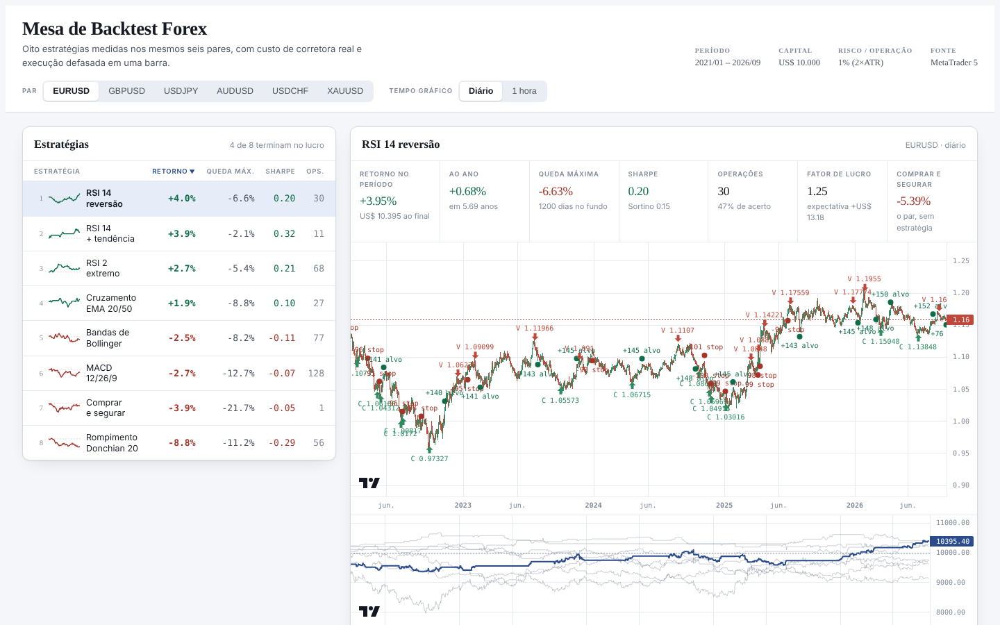

# Mesa de Backtest Forex

Motor de backtest que escrevi em Python para testar estratégias clássicas de
forex com custo de corretora de verdade, e um painel para comparar os
resultados lado a lado. Os dados vêm do MetaTrader 5, só leitura: nenhum
código aqui envia ordem.

*English version below.*



## O que ele faz

```
cotações (MT5 ou Yahoo) → cache em CSV → estratégia gera sinais
        → motor simula execução, custo e risco → métricas → painel
```

- 8 estratégias (RSI, médias móveis, Bollinger, MACD, Donchian e comprar e
  segurar como referência) rodando em 6 ativos (EURUSD, GBPUSD, USDJPY,
  AUDUSD, USDCHF, XAUUSD), no diário e no gráfico de 1 hora. São 96
  backtests de 2021 até set/2026.
- Métricas por teste: retorno, CAGR, Sharpe, Sortino, Calmar, queda máxima e
  quanto tempo ficou no fundo, taxa de acerto, fator de lucro, expectativa
  por operação e SQN.
- Painel em HTML que abre direto do disco, com o gráfico de velas, as
  entradas e saídas marcadas e a curva de capital da estratégia contra as
  outras.

## O que os testes mostraram

No gráfico de 1 hora, quase todas as estratégias de indicador perderam
dinheiro depois do custo: o MACD terminou em média com -75%, e Bollinger e
RSI de 2 períodos não deram lucro em nenhum dos 6 ativos. No diário o custo
pesa menos e o resultado fica perto de zero, com o cruzamento de médias
20/50 lucrativo em 5 de 6 ativos, mas com retorno pequeno (média de +5% em
quase 6 anos).

A conclusão que eu tirei: com spread e comissão no cálculo, indicador
sozinho não tem vantagem em timeframe curto.

## Partes que deram mais trabalho

- **Custo realista.** O spread gravado no histórico do MT5 é o mínimo de cada
  barra, otimista demais. O motor usa o maior entre o gravado e um piso por
  ativo, e cobra US$ 7 por lote ida e volta, que é o modelo de conta raw/ECN.
  Somar spread de conta standard com comissão seria cobrar o mesmo custo duas
  vezes.
- **Sem olhar o futuro.** O sinal é calculado no fechamento da barra e
  executado na abertura da seguinte. Compra sai no ask e venda no bid. Quando
  stop e alvo cabem na mesma barra, o motor assume que o stop bateu primeiro.
- **Tamanho por risco.** Cada operação arrisca 1% do capital na distância até o
  stop (2x ATR de 14), com teto de alavancagem. Nos pares cotados contra o
  dólar (USDJPY, USDCHF) o lucro é convertido para USD.
- **Painel sem servidor.** Os resultados viram um `dados.js` que o HTML carrega
  direto, então dá para abrir com duplo clique. A curva de capital é diária e
  as velas só têm dias de pregão, por isso os dois gráficos são sincronizados
  pela data e não pelo índice da barra.

## Tecnologias

Python 3 (pandas, NumPy), MetaTrader5 para os dados, pytest, HTML e JavaScript
com Lightweight Charts no painel.

## Estrutura

| Caminho | O que tem |
|---|---|
| `data.py` | carrega OHLC do MT5 (ou Yahoo) e guarda cache em `data/` |
| `engine.py` | motor: execução, custo, tamanho de posição e métricas |
| `strategies.py` | indicadores e as 8 estratégias |
| `run.py` | roda a matriz de testes e atualiza o painel |
| `dashboard/` | painel (`index.html` + `dados.js` gerado) |
| `tests/` | testes do motor e da causalidade dos indicadores |

## Como rodar

Requisitos: Python 3.10+. O repositório traz o EURUSD (diário e 1 hora) como
amostra e o painel já vem com os 96 resultados.

```bash
pip install -r requirements.txt
python run.py --pares EURUSD --tempos D1 H1   # roda só com a amostra
python -m pytest                              # testes
```

Depois é só abrir `dashboard/index.html` no navegador.

Para baixar os outros ativos é preciso o terminal do MetaTrader 5 aberto no
Windows (`pip install MetaTrader5` e `python data.py`). Sem ele dá para usar o
Yahoo, só no diário e com spread estimado: `pip install yfinance` e
`python run.py --fonte yahoo --tempos D1`.

## Como adicionar uma estratégia

Uma função que recebe o DataFrame e devolve `Signals`, registrada em
`CATALOGO` no fim de `strategies.py`:

```python
def minha_ideia(df, sl_mult=2.0, tp_mult=3.0) -> Signals:
    s = Signals(len(df))
    s.long_entry  = <array booleano>
    s.short_entry = <array booleano>
    _risk(s, df, 14, sl_mult, tp_mult)
    return s
```

## Limitações

- Execução no preço de abertura, sem slippage além do spread.
- Os parâmetros são os clássicos de livro, sem otimização. É de propósito:
  otimizar no mesmo período que se mede só ajusta a estratégia ao passado.
- Não há swap (custo de carregar posição de um dia para outro).
- Resultado de backtest não é promessa de resultado futuro.

---

## English

A forex backtesting engine I wrote in Python to test classic strategies with
real broker costs, plus a dashboard to compare the results side by side. Data
comes from MetaTrader 5 in read-only mode; nothing here sends orders.

**What it does**: 8 strategies (RSI, moving averages, Bollinger, MACD,
Donchian and buy-and-hold as a benchmark) on 6 instruments, daily and hourly,
96 backtests from 2021 to Sep 2026. Each run reports return, CAGR, Sharpe,
Sortino, Calmar, max drawdown and its duration, win rate, profit factor,
expectancy and SQN.

**What I found**: once spread and commission are included, almost every
indicator strategy loses money on the hourly chart (MACD averaged -75%).
On the daily chart results sit close to zero. Indicators alone show no edge
on short timeframes.

**Highlights**

- **Realistic costs**: the larger of the recorded spread and a per-instrument
  floor, plus a US$ 7 round-trip commission per lot (raw/ECN model).
- **No look-ahead**: signals are computed on bar close and filled on the next
  bar's open, buys at the ask, sells at the bid, and the stop wins when stop
  and target fall inside the same bar. Tests check that every indicator gives
  the same signals with or without future data.
- **Risk-based sizing**: 1% of equity per trade at a 2x ATR(14) stop, with a
  leverage cap and P&L converted to USD for USD-base pairs.
- **Serverless dashboard**: results are exported to a `dados.js` file, so the
  HTML opens straight from disk. The equity and candle charts are synced by
  date, not by bar index.

**Stack**: Python 3 (pandas, NumPy), MetaTrader5, pytest, HTML/JavaScript with
Lightweight Charts.

**Running it**: see *Como rodar* above. The commands are the same; the code
and the dashboard are in Portuguese.
